# ClockMu

An alarm clock for **[muOS (MustardOS)](https://muos.dev/)** on the **Anbernic RG35XX family** (all Allwinner H700 — Pro, Plus, H, SP, 2024). Built with LÖVE2D on the shared **[fskit](#-built-on-fskit)** kit. Jacaranda-compatible.

> **muOS Releases:** The **Nov Release** includes packages for both:
> - **Andromeda 2.0.0** — for muOS 2606.0 Andromeda (device-tested on RG35XX Pro)
> - **Supernova 3.0.0** — for muOS 2612 Supernova (device-tested on RG35XX Pro)
>
> Both builds share the same core code. Choose the `.muxapp` corresponding to your installed muOS version.

*Drew inspiration from [BitMuos](https://github.com/nvcuong1312/bltMuos) by [nvcuong1312](https://github.com/nvcuong1312).*

  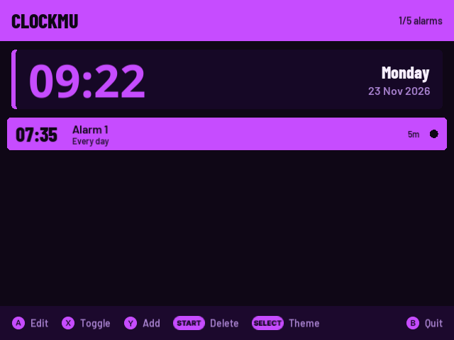

---

## 📸 Screenshots

| Alarm List & Status | Edit Alarm & Presets |
| :---: | :---: |
| 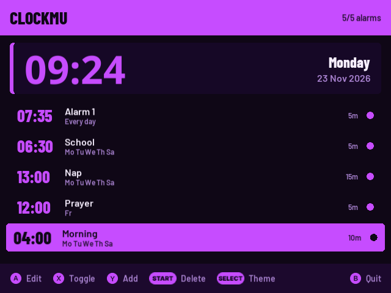 | 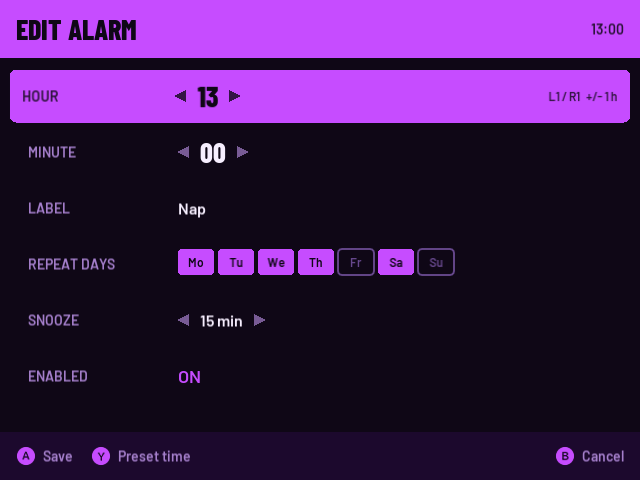 |

| On-Screen Keyboard | Theme Picker |
| :---: | :---: |
| 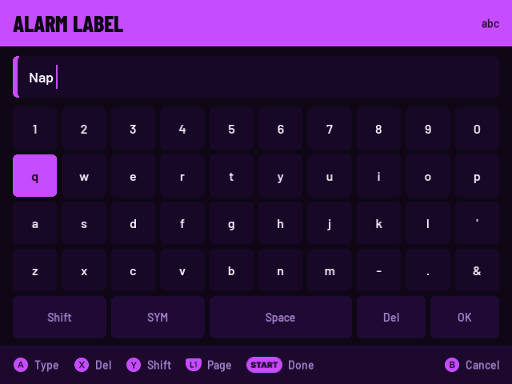 |  |

---

## 🚀 Features

- **Up to 5 Alarms**: Daily, specific weekdays, or one-shot alarms.
- **Configurable Snooze**: Snooze duration per alarm (5 / 10 / 15 min); snoozed alarms ring again when the timer expires.
- **Quick Presets & Custom Labels**: 15-minute interval time presets and full on-screen keyboard (letters and symbols) for labels up to 20 characters.
- **10 Colour Themes**: Mustard, Crimson, Ocean, Funky, and Andromeda (each in Dark and Light).
- **Multi-Resolution Layouts**: 640×480 (RG35XX family), 720×480, and 720×720 display support.
- **Data Persistence**: Persistent settings and alarms saved across reboots independently of LÖVE save directories.

---

## 📥 Installation

1. Download the `.muxapp` for your muOS version from the latest [Release](https://github.com/fragilesilver/ClockMu/releases):
   - `ClockMu-2.0.0.muxapp` for **muOS Andromeda (2606.0)**
   - `ClockMu-3.0.0.muxapp` for **muOS Supernova (2612)**
2. Copy the file to `ARCHIVE/` on your SD card.
3. On your device: open **Applications → Archive Manager** and select the file to install.
4. Launch from **Applications → ClockMu**.

---

## 🎮 Controls

### Alarm List

| Button | Action |
|--------|--------|
| **Up / Down**, **L1/R1**, **L2/R2** | Move / page / jump 100 entries |
| **A** | Edit selected alarm |
| **X** | Toggle alarm on / off |
| **Y** | Add new alarm (prompts if 5 already exist) |
| **START** | Delete selected alarm (confirms first) |
| **SELECT** | Open Theme picker (Y toggles Dark / Light) |
| **B** | Quit (confirms first) |

### Edit Alarm

| Button | Action |
|--------|--------|
| **Up / Down** | Navigate fields (Hour, Minute, Label, Repeat, Snooze, Enabled) |
| **Left / Right** | Adjust value (±1 hour/min, cycle options) |
| **L1 / R1** | Quick step (Hour: ±1 h, Minute: ±10 min) |
| **A** on Label | Open label picker / on-screen keyboard |
| **A** on Repeat | Toggle selected weekday |
| **X** on Repeat | Clear all weekdays (set to Once) |
| **A** / **START** | Save alarm |
| **Y** | Open preset time picker |
| **B** | Cancel editing |

### When an Alarm Rings

| Button | Action |
|--------|--------|
| **A** | Snooze (per alarm duration) |
| **B** | Dismiss alarm |

*Alarms take screen priority over all menus and dialogs. Input is buffered for the first 0.35s to prevent accidental dismissals.*

---

## 💾 Data Persistence & Storage

Alarms and configuration are stored in `save/` under the application directory (via the `CLOCKMU_DATA` environment variable exported by the launcher) whenever alarms are modified, dismissed, or toggled. Data persists across reboots and package upgrades independently of LÖVE's default save directories.

---

## 📝 Notes

- Alarms fire while ClockMu is the foreground active application.
- One-shot alarms automatically disable themselves after ringing.
- The application launcher sets maximum system volume upon launch and restores your prior volume level upon exit.

---

## 🎨 Themes

Ten in-app colour themes powered by the shared fskit palette: **Mustard** (default), **Crimson**, **Ocean**, **Funky**, and **Andromeda**, each available in both Dark and Light variants.

| Dark | Light |
| :---: | :---: |
| 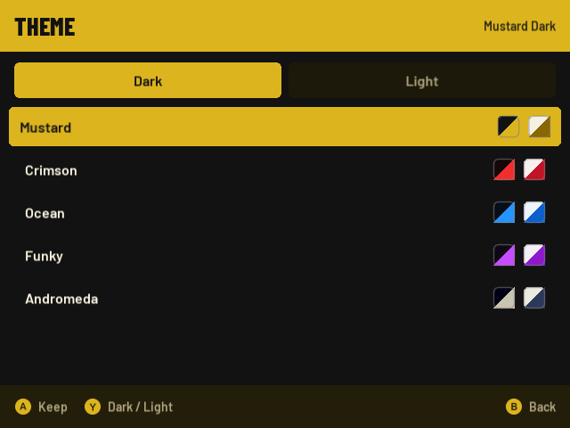 | 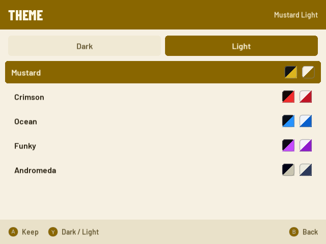 |
| 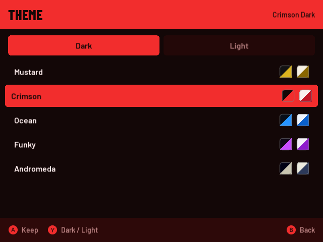 | 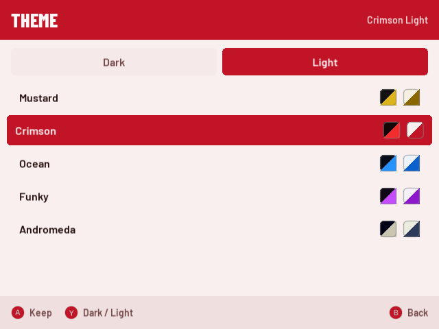 |
| 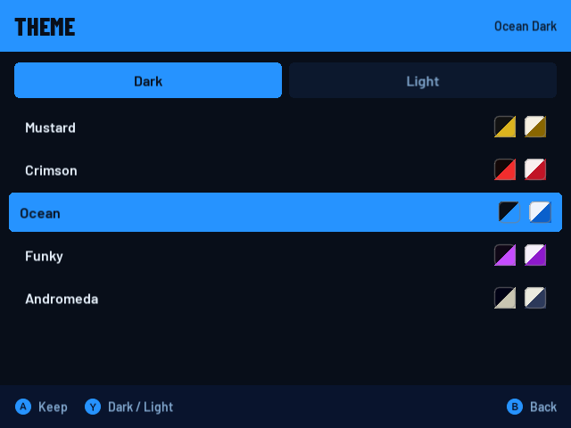 | 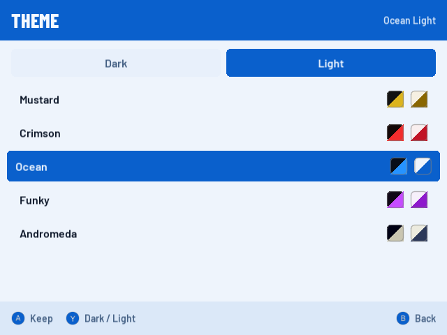 |
| 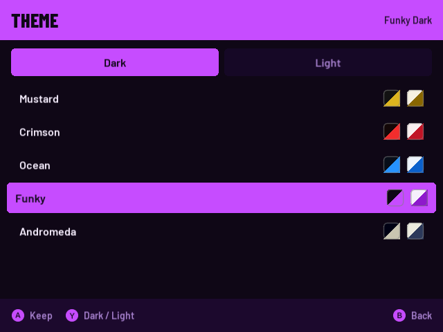 | 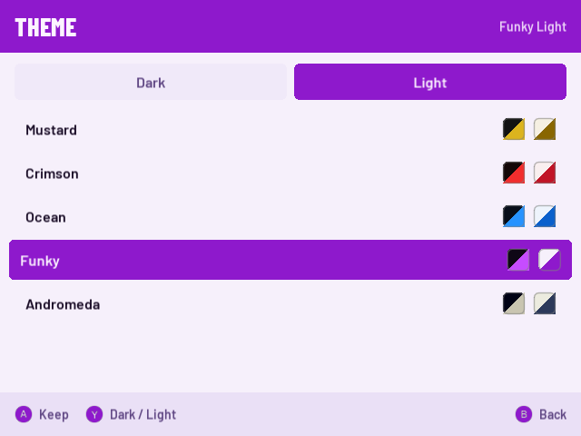 |
| 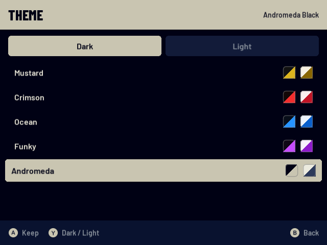 | 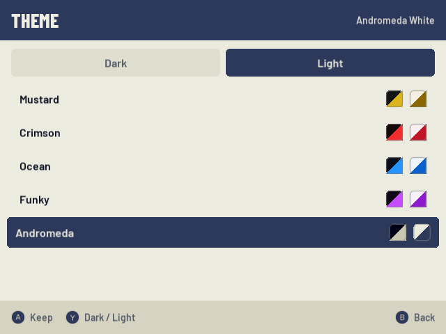 |

---

## 🧩 Built on fskit

ClockMu, [BatteryMu](https://github.com/fragilesilver/BatteryMu), [JarMu](https://github.com/fragilesilver/JarMu), [SwapMu](https://github.com/fragilesilver/SwapMu), [ScrapMu](https://github.com/fragilesilver/ScrapMu), and [LlamaMu](https://github.com/fragilesilver/LlamaMu) share **fskit** — a lightweight LÖVE2D framework providing native display profiles, palettes, Barlow typography (SIL OFL), glyph rendering, input handling, and standard UI widgets.

---

## 🙏 Credits

- Inspired by [BitMuos](https://github.com/nvcuong1312/bltMuos) by [nvcuong1312](https://github.com/nvcuong1312)
- LÖVE2D aarch64 runtime by [Cebion/love2d_aarch64](https://github.com/Cebion/love2d_aarch64)
- Built for the muOS community

---

## 📄 Licence

This project is licensed under the **GNU General Public License v3.0 (or later)** with a strict **Non-Commercial Exception**.

- **For Users & Developers:** You are free to use, share, study, and modify this application for personal, non-commercial use.
- **For Commercial Sellers:** You are **strictly prohibited** from selling this application, charging fees for it, or pre-loading it onto commercial handheld devices or SD cards sold for profit.

See the [LICENSE](./LICENSE) file for the full legal terms.

---

Part of the **fragilesilver** muOS app family — [BatteryMu](https://github.com/fragilesilver/BatteryMu) · [ClockMu](https://github.com/fragilesilver/ClockMu) · [JarMu](https://github.com/fragilesilver/JarMu) · [SwapMu](https://github.com/fragilesilver/SwapMu) · [ScrapMu](https://github.com/fragilesilver/ScrapMu) · [LlamaMu](https://github.com/fragilesilver/LlamaMu)
